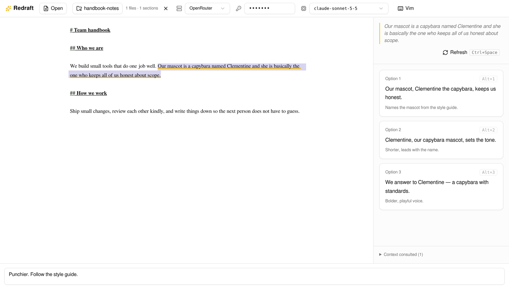
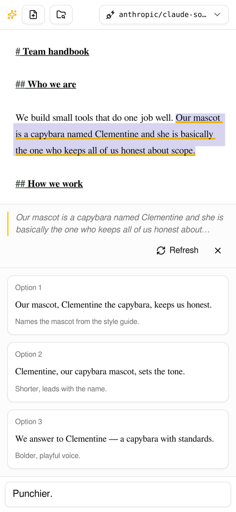

<div align="center">

# Redraft

**Select a sentence, press <kbd>Ctrl</kbd>+<kbd>Space</kbd>, get three better ones.**

An AI rewriting editor that runs entirely in your browser. Bring your own model, point it at
your notes, and keep your words off everyone's server but the model's.

[](https://github.com/meatcar/redraft/actions/workflows/ci.yml)
[](https://github.com/meatcar/redraft/releases/latest)
[](LICENSE)

[**Try it now**](https://meatcar.github.io/redraft/) ·
[Download](https://github.com/meatcar/redraft/releases/latest) ·
[How it works](#how-it-works)





</div>

## Features

- **Three rewrites on demand.** Select any span and press <kbd>Ctrl</kbd>+<kbd>Space</kbd>
  (also on macOS). Apply one with a click or <kbd>Alt</kbd>+<kbd>1</kbd>–<kbd>3</kbd>.
- **Steer every suggestion.** Type "punchier", "for a board audience", or "follow the style
  guide" in the box at the bottom.
- **Ground it in your notes.** Pick a folder of markdown. The model searches it with tools
  only when your prompt calls for it, and shows which files it consulted.
- **Bring your own model.** OpenRouter, OpenAI, or any OpenAI-compatible endpoint. Models are
  discovered from the endpoint; keys are stored per endpoint in your browser.
- **Client-side only.** Your document, notes, and key go straight from your browser to the
  model. There is no Redraft backend.
- **One verifiable file.** Each release is a single 2.2 MB HTML file with a GitHub build
  provenance attestation. Open it from disk, offline from everything but your model.
- **Works on your phone.** Select with the usual handles and tap **Suggest**; rewrites slide
  up under the document.
- **Markdown editor with Vim mode**, built on CodeMirror 6.

## Quick start

1. Open **[meatcar.github.io/redraft](https://meatcar.github.io/redraft/)**, or download
   `redraft.html` from the [latest release](https://github.com/meatcar/redraft/releases/latest)
   and open it.
2. Click **Connect a model**, pick a provider, paste its API key, and choose a model.
3. Paste or open a markdown document, select some text, and press <kbd>Ctrl</kbd>+<kbd>Space</kbd>
   (or tap **Suggest**).

Optional: click **Context folder** to let the model search your notes.

## Privacy and verification

Redraft has no server of its own. Requests go from your browser to the endpoint you choose,
and settings live in `localStorage`. A custom endpoint must allow CORS from the page's origin.

Every release is built by [GitHub Actions](.github/workflows/release.yml) and attested. Check
that a file is exactly what CI built from a tagged commit:

```sh
gh attestation verify redraft.html --repo meatcar/redraft
```

GitHub Pages serves the same attested bytes: the latest release at `/redraft/` and each
release at `/redraft/<tag>/`. An attestation proves where the file came from, not what it
does; the source for each tag is public for that.

## How it works

```
Ctrl+Space ─▶ sync context index ─▶ model loop with tools ─▶ exactly 3 { text, rationale }
                                    │
                                    ├─ read_around_selection, search_document
                                    └─ search_context, read_context_file
```

- The first prompt holds only the selection and your steering. The model calls tools when it
  needs more, so short requests stay short.
- The context folder is indexed in memory with MiniSearch (BM25+). The index stores terms,
  not file bodies: snippets are read from your files. Each request resyncs
  changed, added, and deleted files first.
- Chromium reads the folder live through the File System Access API. Other browsers upload
  a snapshot.
- Any OpenAI-compatible endpoint that supports `response_format: json_schema` works.

## Development

Requires [Nix](https://nixos.org) (or Bun 1.3+ on your own).

```sh
nix develop            # or: direnv allow
bun install
bun run dev            # http://localhost:3000
bun run build:html     # dist/redraft.html
```

Checks:

```sh
bun test
bun run check          # tsc, oxlint, fallow, treefmt
nix flake check
```

`bun run start` serves the app with `NODE_ENV=production`; the only server setting is
`PORT` (see `.env.example`). Releases are cut by pushing a `v*` tag.

Built with React 19, CodeMirror 6, shadcn/ui, Tailwind 4, the Vercel AI SDK, and
MiniSearch. Contributors and agents: see [AGENTS.md](AGENTS.md).

## License

[Apache License 2.0](LICENSE). Attributions are in [NOTICE](NOTICE); the single-file build
ends with an HTML comment holding the license of every bundled package.
